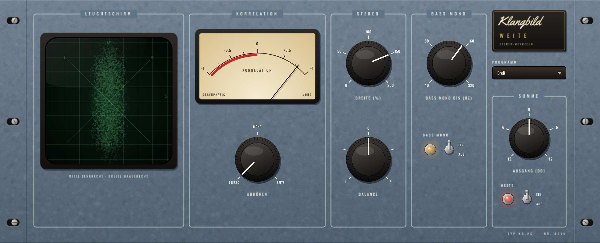

# Klangbild Weite

Stereo-Werkzeug im Rack-Look: Stereobreite, Bass auf Mono, Balance – dazu ein Korrelationsmesser für
Phasenprobleme, ein grüner Leuchtschirm (Goniometer), der das Stereobild live zeigt, und eine Mono-Kontrolle.
Audio Unit für Logic Pro (außerdem VST3 und Standalone), gebaut mit [JUCE](https://juce.com).



## Bedienung

| Regler | Wirkung |
|---|---|
| **Breite** | 0 % = mono · 100 % = unverändert · 200 % = doppelt so breit (Seitenanteil +6 dB) |
| **Bass mono bis** + Schalter | legt alles unterhalb von 40 … 320 Hz in die Mitte – sauberer, druckvoller Bass, wichtig für Vinyl, Clubs und Handy-Lautsprecher |
| **Balance** | links/rechts – die Gegenseite wird abgesenkt, die Mitte bleibt bei 0 dB |
| **Abhören** | Stereo · **Mono** (Mono-Kontrolle) · **Seite** (nur der Raum-/Breitenanteil) – wirkt nur aufs Abhören, nicht auf die Anzeigen |
| **Ausgang** | ±12 dB |
| **Weite Ein/Aus** | Bypass, bitgenau |

### Anzeigen
- **Leuchtschirm**: Mitte senkrecht, Breite waagerecht. Ein senkrechter Strich = mono, eine runde Wolke = breit,
  ein waagerechter Strich = gegenphasig (Vorsicht!). Die Empfindlichkeit passt sich automatisch an.
- **Korrelation**: +1 = mono-kompatibel, um 0 = sehr breit, im roten Bereich (unter 0) = Phasenprobleme –
  in Mono würden Teile des Signals verschwinden.

### Presets
Neutral · Bass mono (120 Hz) · Etwas breiter · Breit · Schmaler · Mono (fast)

## Technik & Messwerte (48 kHz)
- Mitte/Seite-Verarbeitung, keine Latenz; Neutralstellung praktisch verlustfrei (Abweichung 1,5·10⁻⁸)
- Bass mono: Linkwitz-Riley-Weiche 4. Ordnung auf dem Seitensignal, die Mitte läuft durch den passenden Allpass –
  dadurch bleiben Mitte und Seite phasengleich und der Frequenzgang eines Mono-Signals ist exakt flach (±0,00 dB)
- Signal nur links, Bass mono bei 120 Hz: 40 Hz wird 38 dB in die Mitte gezogen, 2 kHz bleibt unverändert
- Breite 50 / 150 / 200 %: Seitenanteil exakt −6,02 / +3,52 / +6,02 dB
- Korrelation: mono +1,00, gegenphasig −1,00, unabhängige Signale 0,01

## Installation in Logic Pro

Tab **Actions** → letzter grüner Lauf → **Artifacts** → `Klangbild-Weite-macOS`, dann:

1. `Klangbild-Weite-AU.zip` entpacken → `Klangbild Weite.component`
2. Finder → ⇧⌘G → `~/Library/Audio/Plug-Ins/Components` → Datei hineinkopieren
3. Einmal im Terminal:
   ```
   xattr -dr com.apple.quarantine ~/Library/Audio/Plug-Ins/Components/"Klangbild Weite.component"
   ```
4. Logic starten: **Audio Units → Klangbild → Klangbild Weite** (nur auf Stereo-Spuren/-Bussen)

## Lizenzen

Schriften *Oswald* (OFL 1.1) und *Yellowtail* (Apache 2.0) – Lizenztexte in `Resources/`.
JUCE: AGPLv3 bzw. kommerziell – für den privaten Gebrauch unproblematisch.
